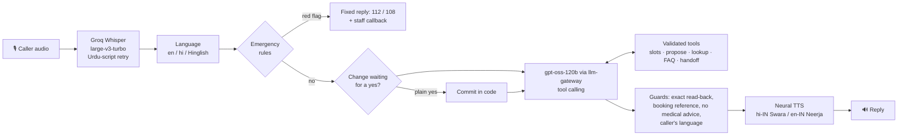

# Riya: a Hindi + English voice receptionist

[](https://github.com/Tanzil-Ali-Rizvi/voice-receptionist/actions/workflows/ci.yml)
[](https://github.com/Tanzil-Ali-Rizvi/voice-receptionist/actions/workflows/eval.yml)
[](https://tanzil-voice-receptionist.streamlit.app)


**A voice receptionist for a clinic that callers can speak to in English, Hindi or Hinglish.** Riya books, moves and cancels appointments, answers clinic questions, and hands emergencies and anything medical to people. The LLM decides *what to say*; code decides *what is allowed to happen*.

**[Talk to Riya →](https://tanzil-voice-receptionist.streamlit.app)** (browser microphone, or type)

> Sehat Family Clinic, its doctors and patients are fictional. Each visitor gets a private copy of the calendar.



## Design decisions

| Risk at a real front desk | What the code does |
|---|---|
| The model "books" something the caller never agreed to | `propose_booking`, `propose_reschedule` and `propose_cancel` only create a pending change. It is committed by code after a **deterministic** yes check (`haan ji`, `हाँ, कर दीजिए`, `yes`), and "haan but make it 5 pm" does not count. The model has no tool that commits. |
| The model says "booked" when nothing was booked | Whenever a change is proposed, the reply is replaced with an exact read-back generated from the pending change; after a commit, the booking reference is always spoken. |
| A caller describes an emergency | Rules in English, Devanagari Hindi and Hinglish (`seene mein dard`, `सांस लेने में दिक्कत`, `behosh`) run **before** the LLM and return a fixed answer (112 / 108, Tele-MANAS 14416 for self-harm) plus a staff callback. Over-triggering is accepted. |
| Medical advice | The prompt forbids it, and an output guard replaces any reply that looks like dosing or treatment ("500 mg", "Dolo le lijiye") with an offer to book. |
| Someone asks about another patient | Appointments are only revealed when the caller gives the phone number **and** the name on the booking; reschedule and cancel refuse unverified references. |
| Hallucinated slots, dates, phone numbers | Every tool argument is validated: the doctor works that day, the slot exists and is free, the date is within 14 days, and the number is a valid Indian mobile. |
| Mixed-language callers | Each turn is classified as English, Hindi or Hinglish. Hindi and Hinglish callers are answered in Devanagari Hindi (which the Hindi voice reads well), and a reply in the wrong script is rewritten once. Whisper output in Urdu script triggers a re-transcription pinned to Hindi. |
| Phone numbers in logs | The dashboard and tool trace mask numbers (`98******34`). |

## Results

<!-- RESULTS -->

## How it's built

| Part | Choice | Why |
|---|---|---|
| Speech to text | Groq `whisper-large-v3-turbo` (vs `whisper-large-v3` in the eval) | Fast, handles Hindi, free tier |
| LLM | `gpt-oss-120b` on Groq through **[llm-gateway](https://github.com/Tanzil-Ali-Rizvi/llm-gateway)** (my project), in-process | Retries, fallback to `gpt-oss-20b`, cost tracking |
| Text to speech | Microsoft neural voices via `edge-tts` (`hi-IN-SwaraNeural`, `en-IN-NeerjaNeural`), Google TTS fallback | Groq's TTS voices are English and Arabic only |
| State | One in-memory SQLite calendar per call, seeded with other patients | Realistic availability; visitors can't see each other |
| UI | Streamlit with `st.audio_input` | Runs anywhere, no install |

```
src/receptionist/
  agent.py      one turn: language, emergency rules, confirmation gate, LLM + tools, output guards
  tools.py      validated tools and the two-phase commit
  clinic.py     doctors, hours, the appointment book, FAQ
  lang.py       en / hi / Hinglish detection, script checks, strict yes/no
  safety.py     emergency rules, medical-advice guard, phone masking
  speech.py     Groq Whisper STT, edge-tts / gTTS TTS
  evaluate.py   simulated-caller evaluation (resumable)
  stt_eval.py   FLEURS WER/CER and clinic-detail accuracy
app/streamlit_app.py
evals/scenarios.yaml
```

## Run it

```bash
pip install -e ".[llm,speech,app,dev]"
export GROQ_API_KEY=...
streamlit run app/streamlit_app.py

pytest -q                                  # 58 tests, no network or keys needed
python -m receptionist.evaluate            # simulated callers (resumes if it hits the daily token limit)
python -m receptionist.stt_eval            # FLEURS + clinic-detail speech-to-text accuracy
```

## Limitations

- Turn-based (record, then send), not full-duplex streaming; no barge-in. A phone line (Twilio + streaming STT) is the natural next step.
- English and Hindi only; Hinglish replies come back in Devanagari Hindi, not in Latin script.
- Emergency rules are keyword patterns: high recall on the phrasings tested, but not a clinical triage system.
- The clinic-detail speech test uses synthesised voices, which are cleaner than real phone audio.
- `edge-tts` uses Microsoft's public Edge voice service, which is not a formal API; the app falls back to Google TTS if it changes.

## License

MIT
